# FinFlow

Aplicación de finanzas personales **móvil-first**, con interfaz de escritorio completa:
movimientos, métricas, planes/metas, deudas, cuentas, categorías, presupuestos y ajustes.
Construida con **SvelteKit + Svelte 5 (runes)**, **TypeScript estricto**, **Tailwind CSS v4**
y **Supabase** (Auth + Postgres + Storage).

- **Índice**
  - [Capturas](#capturas)
  - [Características](#características)
  - [Stack](#stack)
  - [Requisitos](#requisitos)
  - [Configuración](#configuración)
  - [Desarrollo](#desarrollo)
  - [Scripts](#scripts)
  - [Estructura](#estructura)
  - [Base de datos](#base-de-datos)
  - [PWA e instalación](#pwa-e-instalación)
  - [Notificaciones push](#notificaciones-push)
  - [Datos de demostración](#datos-de-demostración)
  - [Pruebas](#pruebas)
  - [Notas de diseño](#notas-de-diseño)
  - [Seguridad en producción](#seguridad-en-producción)

## Capturas

Las capturas corresponden a la cuenta de demostración (perfil Sofía Ramírez, moneda USD) con
datos de ejemplo de noviembre de 2026.

### Escritorio

| Inicio                                                          | Movimientos                                                               |
| --------------------------------------------------------------- | ------------------------------------------------------------------------- |
| 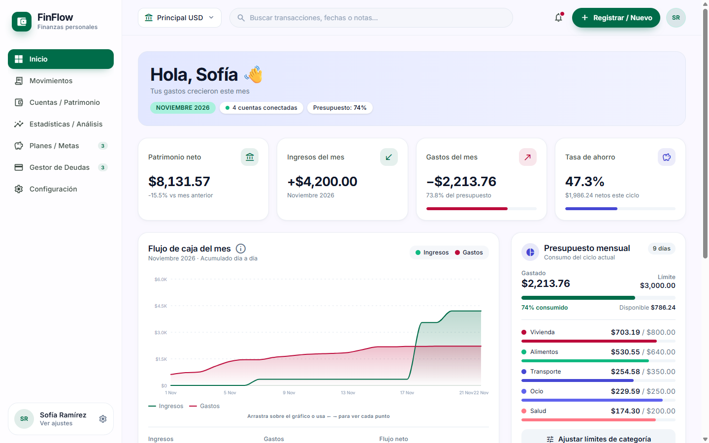 | 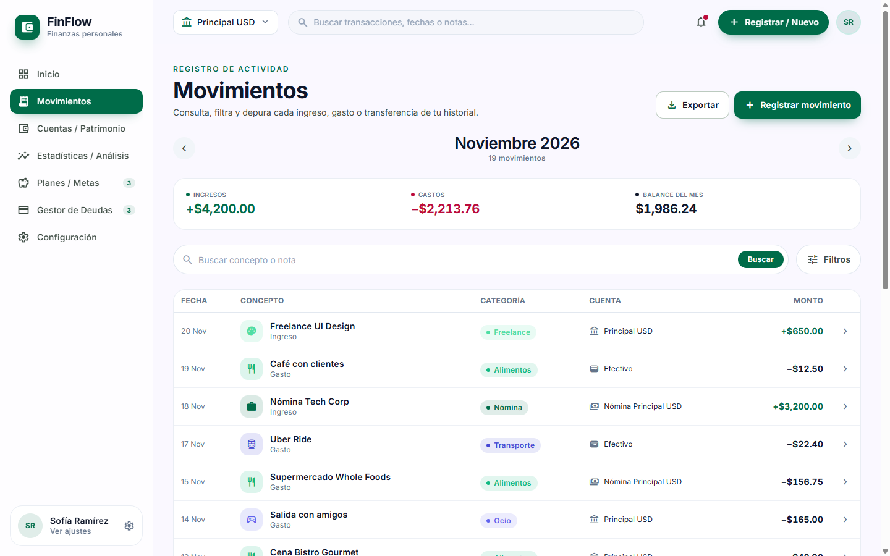 |

| Métricas                                                            | Planes y metas                                                  |
| ------------------------------------------------------------------- | --------------------------------------------------------------- |
| 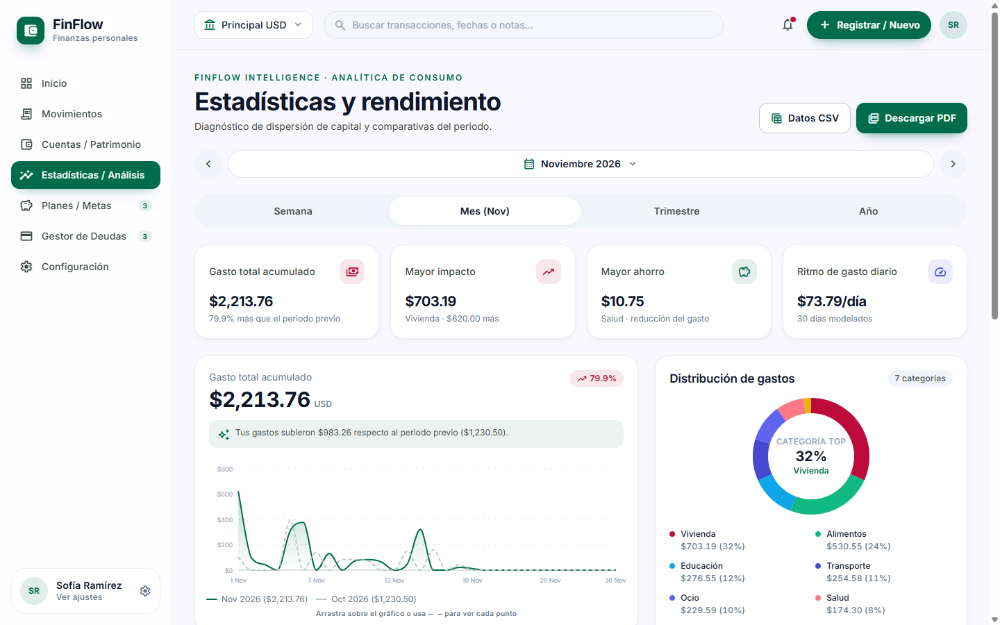 | 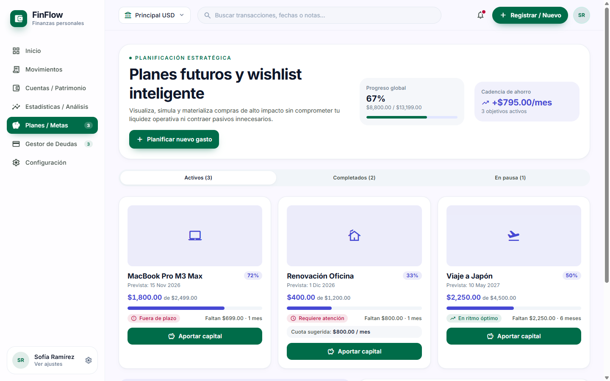 |

| Deudas                                                          | Cuentas                                                           |
| --------------------------------------------------------------- | ----------------------------------------------------------------- |
| 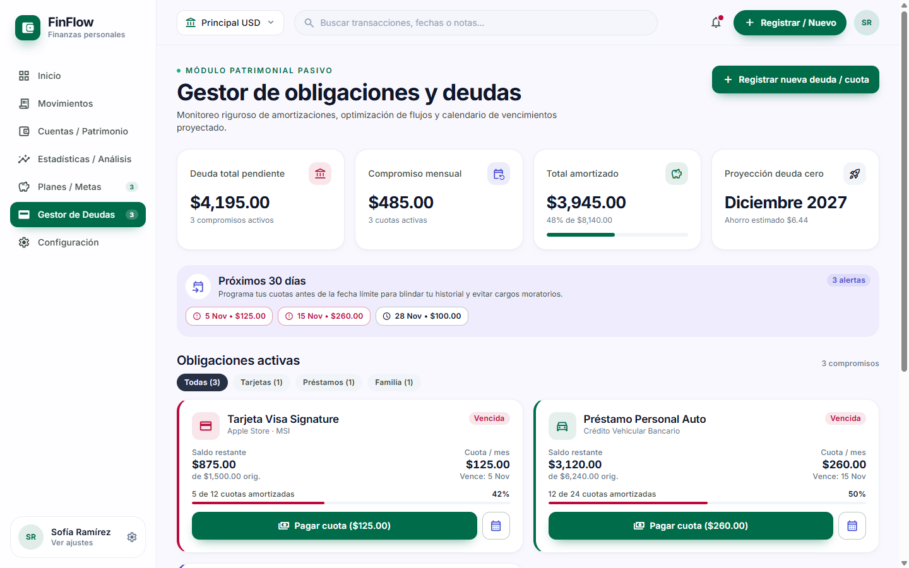 | 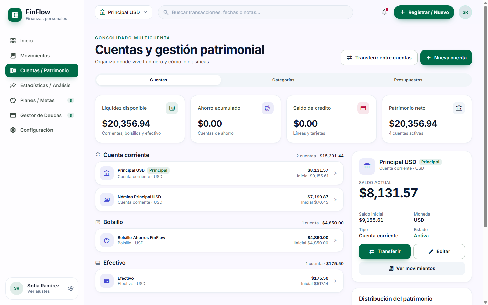 |

| Ajustes                                                           | Apariencia                                                              |
| ----------------------------------------------------------------- | ----------------------------------------------------------------------- |
| 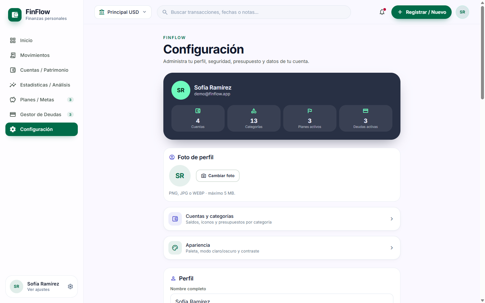 | 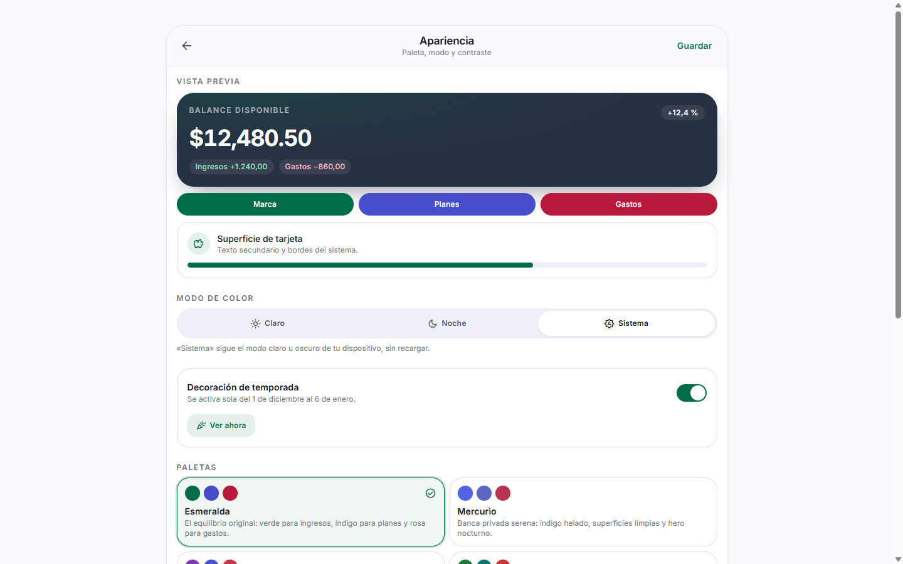 |

### Móvil

| Acceso                                                             | Inicio                                                    | Movimientos                                                         |
| ------------------------------------------------------------------ | --------------------------------------------------------- | ------------------------------------------------------------------- |
| 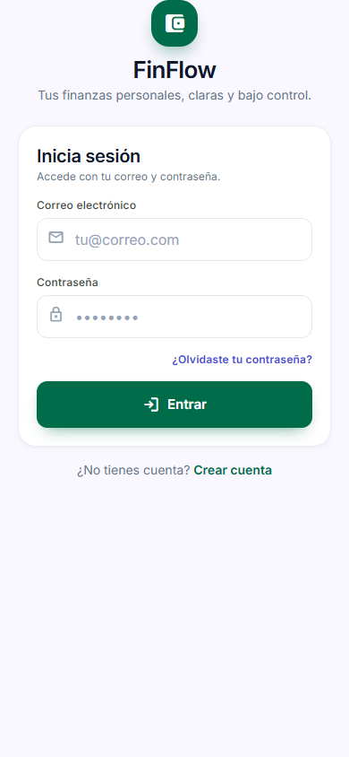 | 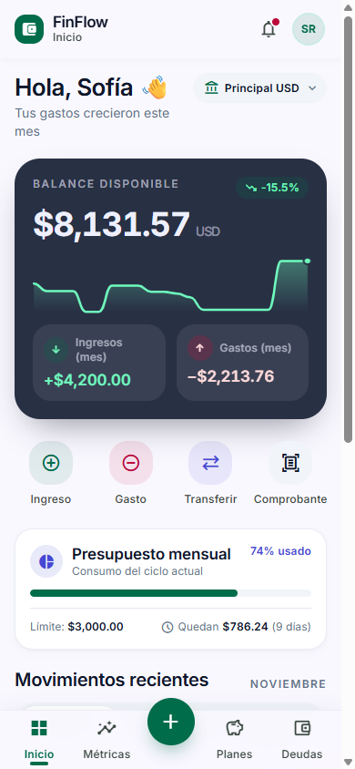 | 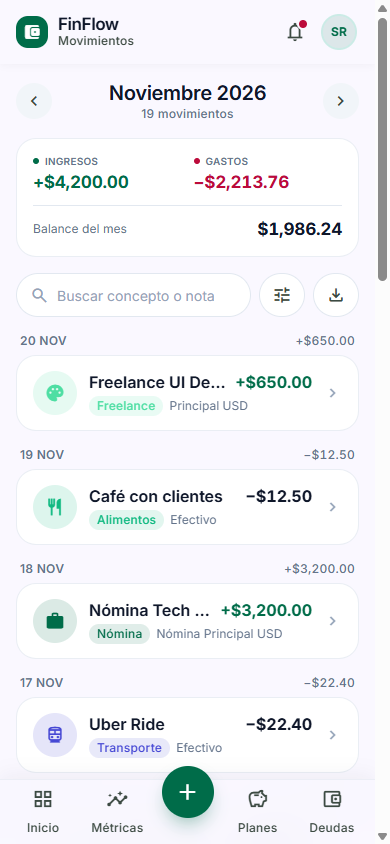 |

| Métricas                                                      | Planes                                                    | Deudas                                                    |
| ------------------------------------------------------------- | --------------------------------------------------------- | --------------------------------------------------------- |
| 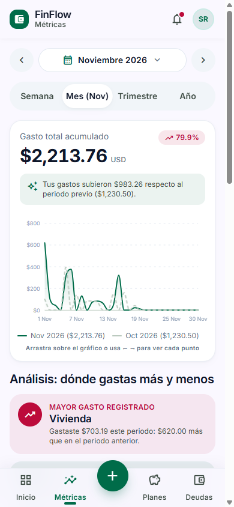 | 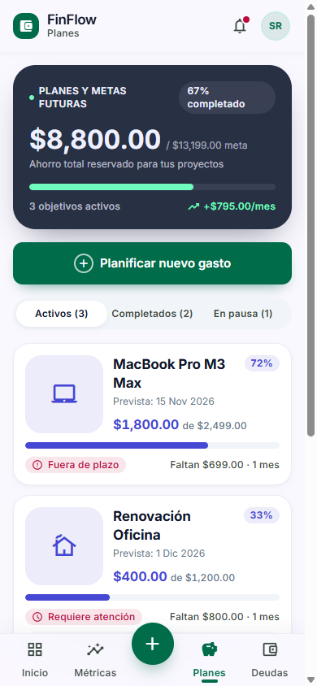 | 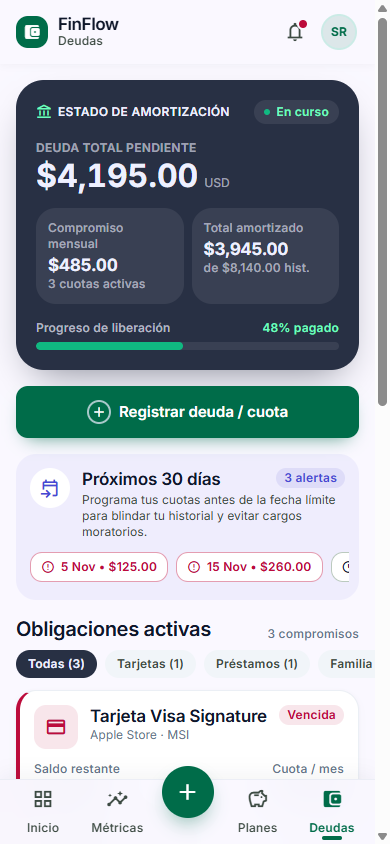 |

| Cuentas                                                     | Ajustes                                                     | Apariencia                                                        |
| ----------------------------------------------------------- | ----------------------------------------------------------- | ----------------------------------------------------------------- |
| 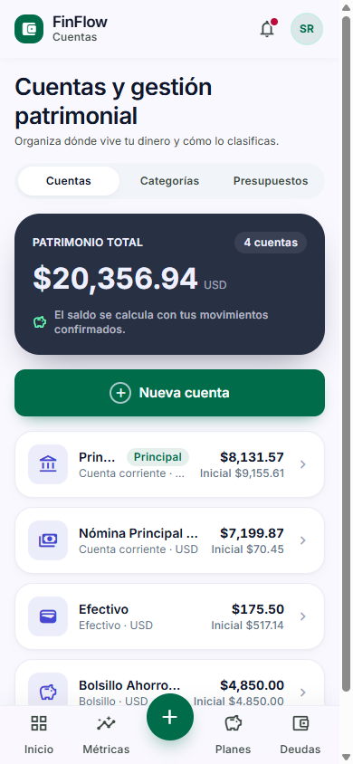 | 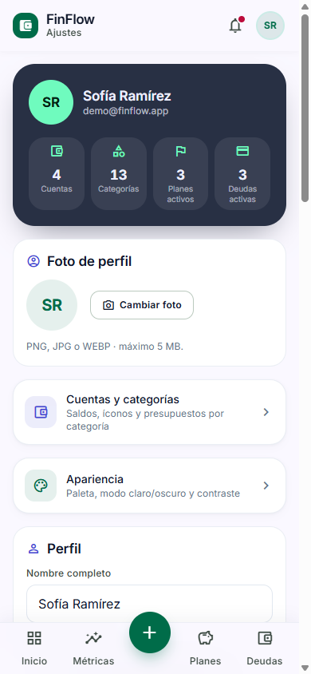 | 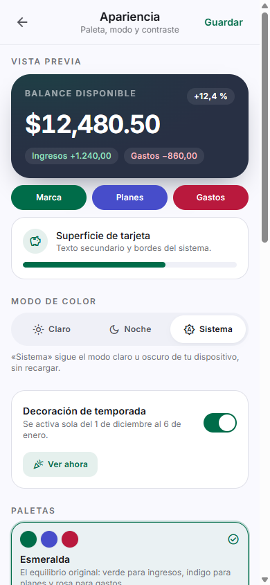 |

## Características

- **Inicio**: patrimonio neto con sparkline, ingresos/gastos del mes, tasa de ahorro, flujo de
  caja acumulado día a día, presupuesto global con progreso y límites por categoría, y
  movimientos recientes.
- **Movimientos**: lista por mes con navegación, búsqueda por concepto/nota, filtros (tipo,
  cuenta, categoría), alta de gasto/ingreso/transferencia, comprobante adjunto (imagen, sin
  OCR), edición y borrado desde el detalle.
- **Exportación desde Movimientos**: informe **PDF**, libro **Excel (.xlsx)** con montos
  numéricos, **CSV** y **HTML estilizado**, respetando el mes y los filtros activos.
- **Métricas**: periodos semana / mes / trimestre / año, comparación contra el periodo previo,
  mayor impacto y mayor ahorro por categoría, ritmo de gasto diario, desglose con donut, serie
  temporal y exportación a **CSV/PDF**.
- **Planes y metas**: aportaciones por plan, ritmo de ahorro (adelantado / a tiempo / atrasado /
  vencido), proyección de fecha de alcance, cuota sugerida, pausar, completar y reactivar.
- **Deudas**: amortización con MSI / interés fijo / interés variable, frecuencia **semanal,
  quincenal o mensual**, fecha de origen, monto ya entregado, cuotas pagadas con calendario,
  días de aviso configurables, proyección tipo bola de nieve e icono por obligación. Los pagos
  son atómicos (`pay_installment`) y generan el gasto asociado.
- **Cuentas y categorías**: cuentas con saldo inicial, moneda (no editable), cuenta principal
  única, archivado y borrado solo sin movimientos; categorías con catálogo de iconos agrupado,
  buscador y color; presupuestos por categoría y mes.
- **Multicuenta y multimoneda**: consolidado patrimonial por tipo de cuenta y catálogo de
  monedas propio (Ajustes → Monedas) con USD y EUR como base.
- **Apariencia**: 9 paletas (Esmeralda, Mercurio, Nubank, Wise, Revolut, Cobalto, Grafito,
  Navidad y Terracota), modo **claro / noche / sistema**, paleta personalizada con contraste
  AA y **decoración de temporada** (Navidad del 1 de diciembre al 6 de enero).
- **Escritorio**: sidebar, barra superior con búsqueda global, tablas y tarjetas a varias
  columnas, manteniendo el mismo flujo que la vista móvil.
- **Ajustes**: perfil, foto, moneda principal, presupuesto, monedas, apariencia, notificaciones,
  cambio de contraseña, exportaciones y cierre de sesión (solo POST).
- **PWA instalable**: manifest, iconos propios, service worker con página offline y sección
  "Instalar aplicación" (con instrucciones para iOS).
- **Notificaciones push**: avisos de cuotas y aportes a la hora local de cada perfil.
- **Seguridad**: RLS en todas las tablas, claves solo por variables de entorno, validación con
  Zod, redirecciones internas validadas y traducción de errores de Auth al español.
- **Sin modo demo en la app**: los datos se cargan siempre desde Supabase. `supabase/seed.sql`
  rellena un dataset de demostración bajo demanda.

## Stack

| Capa        | Tecnología                                                               |
| ----------- | ------------------------------------------------------------------------ |
| Framework   | SvelteKit 3 + Svelte 5 (runes)                                           |
| Lenguaje    | TypeScript estricto                                                      |
| Estilos     | Tailwind CSS v4 (`@tailwindcss/vite`), tokens en `src/routes/layout.css` |
| Datos       | Supabase (Auth + Postgres + Storage), siempre desde el servidor          |
| Validación  | Zod v4                                                                   |
| Exportación | `jspdf` + `jspdf-autotable`, generador `.xlsx` propio y CSV/HTML propios |
| Push        | `web-push` (VAPID) + `pg_cron`/`pg_net`                                  |
| Pruebas     | Vitest (utilidades) + Playwright (E2E)                                   |
| Despliegue  | `@sveltejs/adapter-auto` (Vercel en la práctica)                         |

## Requisitos

- Node.js 24+
- Proyecto de Supabase con las migraciones de `supabase/migrations/` (`0001`–`0014`) aplicadas
  en orden.

## Configuración

```sh
cp .env.example .env
```

| Variable                          | Obligatoria | Descripción                                                                   |
| --------------------------------- | ----------- | ----------------------------------------------------------------------------- |
| `PUBLIC_SUPABASE_URL`             | sí          | URL del proyecto (`https://<ref>.supabase.co`)                                |
| `PUBLIC_SUPABASE_PUBLISHABLE_KEY` | sí          | Clave publicable (segura para el navegador)                                   |
| `SITE_URL`                        | producción  | URL pública para enlaces de confirmación y recuperación                       |
| `PUBLIC_VAPID_PUBLIC_KEY`         | push        | Clave pública VAPID (también viaja al navegador)                              |
| `VAPID_PRIVATE_KEY`               | push        | Clave privada VAPID (`npx web-push generate-vapid-keys`)                      |
| `VAPID_SUBJECT`                   | push        | Contacto del remitente (`mailto:…`)                                           |
| `CRON_SECRET`                     | cron        | Secreto de `/api/cron/notifications` (mínimo 16 caracteres)                   |
| `RECOVERY_COOKIE_SECRET`          | recomendada | Firma la marca del flujo de recuperación (si falta, se usa una clave efímera) |
| `SUPABASE_SERVICE_ROLE_KEY`       | cron        | Solo servidor: la usa el cron para reclamar avisos sin sesión                 |
| `E2E_EMAIL` / `E2E_PASSWORD`      | E2E         | Usuario dedicado de Playwright (nunca en el repositorio)                      |

Sin las variables de push la app funciona igual; Ajustes muestra la sección como no configurada.
La `service_role` key **nunca** se expone al cliente: todo el acceso habitual a Supabase ocurre
en el servidor con la sesión del usuario.

## Desarrollo

```sh
npm install
npm run dev        # http://localhost:5173
```

## Scripts

| Comando             | Descripción                                                                         |
| ------------------- | ----------------------------------------------------------------------------------- |
| `npm run build`     | Compila la app para producción                                                      |
| `npm run preview`   | Sirve el build (http://localhost:4173)                                              |
| `npm run check`     | `svelte-check` con tipado estricto                                                  |
| `npm run check:sw`  | Type-check del service worker                                                       |
| `npm run icons`     | Regenera los iconos PWA desde el logo del navbar                                    |
| `npm run lint`      | Prettier + ESLint de todo el repo                                                   |
| `npm run test:unit` | Vitest: utilidades puras (dinero, fechas, finanzas, validación, CSV, series, temas) |
| `npm run test:e2e`  | Playwright contra `build && preview`                                                |
| `npm run test`      | Ambas suites en orden                                                               |

> Para formatear solo lo que tocaste: `npx prettier --write <archivos>`.

## Estructura

```
src/
  lib/
    components/   # UI kit, componentes de dominio, charts, temporadas
    server/       # capa de datos: queries, mutations, push, alerts, results
    theme/        # paletas, derivación de tokens y packs de temporada
    routes/       # (app) shell, (full) flujos de detalle, (auth) sesión
    utils/        # dinero (centavos), fechas, finanzas, validación, exportación
    types/        # tipos de dominio y tipos generados de la base de datos
  service-worker/ # precache de assets y fallback offline
static/           # manifest, iconos PWA y página offline
scripts/          # generación de iconos
supabase/
  migrations/     # esquema, vistas, RPCs (0001–0014)
  seed.sql        # datos de demostración
e2e/              # pruebas end-to-end
docs/screenshots/ # capturas usadas en este README
```

Rutas principales: `(app)` → `/`, `/movimientos`, `/metricas`, `/planes`, `/deudas`,
`/cuentas`, `/ajustes`; `(full)` → altas y detalles (`/movimientos/nuevo`, `/deudas/[id]`,
`/apariencia`, …); `(auth)` → `/login`, `/registro`, `/recuperar`, `/restablecer`.

## Base de datos

- **Tablas**: `profiles`, `accounts`, `categories`, `transactions`, `tags`, `transaction_tags`,
  `budgets`, `goals`, `goal_contributions`, `debts`, `debt_payments`, `currencies`,
  `push_subscriptions`, `notification_log`, `category_templates`.
- **Vistas** (`security_invoker`): `account_balances`, `transactions_detailed`, `goal_progress`,
  `debt_progress`.
- **RPCs**: `register_transfer`, `pay_installment`, `get_analytics`, `assert_analytics_range`,
  `sync_debt_status`, `claim_due_notifications`, `register_push_subscription`.
- **Migraciones** aplicadas en orden:
  `0001` esquema · `0002` storage · `0003` endurecimiento e índices · `0004` frecuencia y origen
  de deudas · `0005` hardening de RPCs y permisos · `0006` integridad multi-tenant · `0007`
  avatares · `0008` zona horaria · `0009` icono por deuda · `0010` Web Push · `0011` propiedad de
  endpoints push · `0012` catálogo de monedas · `0013` tema · `0014` temporadas visuales.
- No edites migraciones ya aplicadas: crea la siguiente y actualiza `database.types.ts`,
  `domain.ts` y `mappers.ts`.

## PWA e instalación

- `static/manifest.webmanifest` e iconos en `static/icons/` (192, 512, maskable 512 y Apple 180).
  Se generan desde el logo del navbar con `npm run icons` (usa Playwright, sin dependencias nuevas).
- El service worker (`src/service-worker/index.ts`) precachea solo los assets inmutables del
  build y los archivos estáticos. Las navegaciones son **network-first** con fallback a
  `/offline.html`; nunca se cachean datos financieros ni HTML autenticado.
- SvelteKit registra el service worker en producción (en `vite dev` no se registra). Para
  probarlo: `npm run build && npm run preview`.
- En cada navegación del cliente (`afterNavigate`) se ejecuta `registration.update()`. Si hay
  una versión nueva esperando, aparece un banner **"Nueva versión disponible"** que la activa
  con `SKIP_WAITING` y recarga la app.
- En **Ajustes → Instalar aplicación** aparece el botón nativo cuando el navegador lo permite;
  en iOS se muestran los pasos (Compartir → Añadir a pantalla de inicio).

## Notificaciones push

Los avisos de cuotas y aportes se envían con Web Push (VAPID) a cada dispositivo suscrito, una
vez al día y a la hora local del perfil.

- **Preferencias** en Ajustes: interruptor, hora (`profiles.push_time`) y activación por
  dispositivo. El navegador escribe la cookie `tz_offset` y `hooks.server.ts` la persiste en
  `profiles.tz_offset` para que el cron calcule la hora local sin sesión.
- **Selección de avisos**: `claim_due_notifications()` (migración `0010`) devuelve solo lo que
  corresponde a la ventana horaria del usuario y lo reserva en `notification_log`, con clave
  `(user_id, kind, ref_id, local_date)`. Ejecutarla dos veces el mismo día no duplica envíos.
- **Cron**: `GET|POST /api/cron/notifications` con la cabecera `x-cron-secret` (o
  `Authorization: Bearer …`). Programa una ejecución **cada hora**; cada usuario recibe en su
  franja de 60 minutos.
- **Programación en Supabase** (pg_cron + pg_net): guarda el secreto en Vault y ejecuta
  `net.http_post` contra el sitio desplegado. En Vercel Cron, el plan Hobby solo permite una
  ejecución diaria, así que no sirve para horas por usuario.
- **Límites**: en iOS/iPadOS el push requiere Safari 16.4+ con la app **añadida a la pantalla de
  inicio**; en macOS, añadida al Dock. La entrega la gestiona el sistema operativo, no hay
  garantía de minuto exacto.

## Datos de demostración

```sh
psql <tu-conexion> -f supabase/seed.sql
# o pega el contenido en el editor SQL de Supabase
```

El script **exige que el usuario `demo@finflow.app` exista** en Supabase Auth (regístralo antes
desde la app o el panel) y rellena cuentas, categorías, etiquetas, movimientos de septiembre y
octubre de 2026, planes y deudas. No crea el usuario ni define su contraseña. Para las pruebas
E2E usa un usuario propio mediante `E2E_EMAIL` / `E2E_PASSWORD`; no publiques credenciales de
demostración en el repositorio.

## Pruebas

**Unitarias** (Vitest, entorno `node`): 23 archivos y 244 pruebas sobre dinero en centavos,
fechas y zona horaria, cálculos financieros, validación, CSV, series, mappers, rate limiting,
seguridad de contraseñas, errores de Auth, paletas y temporadas.

```sh
npm run test:unit -- --run
npx vitest run src/lib/utils/finance.spec.ts   # una sola suite
```

**E2E** (Playwright): `workers: 1`, `TZ=UTC` y `webServer` con `build && preview` en el puerto 4173. Cubren auth, movimientos, cuentas, categorías, deudas, monedas, ajustes, apariencia,
selectores, notificaciones, PWA, escritorio y zona horaria. Cada caso crea datos con sufijo
temporal y los elimina al terminar; los valores tocados se restauran dentro de la prueba.

```sh
E2E_EMAIL=test@tu-dominio.com E2E_PASSWORD='...' npx playwright test
npx playwright test --ui                       # modo interactivo
npx playwright test e2e/movimientos.e2e.ts     # una sola suite
```

Si faltan `E2E_EMAIL`/`E2E_PASSWORD`, los casos con sesión se omiten.

## Notas de diseño

- El dinero se calcula en **centavos enteros** y se formatea con agrupación `1,234.56`. La
  entrada acepta `1,234.56`, `1234,56` y `$1 234,56`; los montos en la base son `numeric(14,2)`.
- En deudas, `monthly_payment` almacena la **cuota por periodo**; el compromiso mensual se deriva
  de la frecuencia (52/12 semanal, 2 quincenal, 1 mensual) y el interés anual se convierte a tasa
  periódica (÷52, ÷24, ÷12).
- La zona horaria del navegador se guarda en la cookie `tz_offset` (minutos). Los rangos de
  periodo se convierten a instantes UTC para consultar y `get_analytics` recibe el offset; las
  fechas y timestamps se muestran siempre en hora local.
- Los formularios usan `use:enhance` con un helper central que muestra toasts y respeta
  `redirect`. Las pestañas y filtros que viven en la URL se siembran en estado local, porque
  `action="?/nombre"` descarta los parámetros existentes.
- Los gráficos son SVG hechos a mano (sin librerías) con tooltips; el PDF usa `jspdf` y el
  `.xlsx` se genera con un escritor de Office Open XML propio.
- La interfaz da respuesta inmediata: barra de progreso de navegación, atenuado del contenido al
  cambiar de ruta, estados `loading` en cada acción y transiciones de 120–250 ms sobre
  `transform`/`opacity`. Todo respeta `prefers-reduced-motion`.
- Los selectores (cuentas, moneda, tipo de cuenta, filtros y día de recordatorio) usan una **hoja
  inferior** propia (`OptionSheet`) en lugar del menú nativo. Mantienen `name`/`required` con un
  `<select>` oculto y son navegables con teclado (flechas, Home/End, Escape), devolviendo el foco
  al cerrar.
- Las hojas (`Sheet`) atrapan el foco con Tab/Shift+Tab y lo devuelven al disparador;
  `NotificationsSheet` reutiliza el mismo componente con su animación de salida.
- El tema se resuelve en el servidor y se aplica sin parpadeo: las paletas viven en
  `src/lib/theme/palettes.ts`, los tokens se derivan con contraste AA y la preferencia
  (`theme_palette`, `theme_mode`, `theme_custom`, `seasonal_theme`) se guarda en `profiles`.

## Seguridad en producción

- Las migraciones se aplican en orden (ver [Base de datos](#base-de-datos)); no requieren la CLI
  ni Docker.
- Configura `SITE_URL` con el dominio de producción para que los enlaces de confirmación y
  recuperación no dependan del header `Host`.
- Las cookies de sesión son `HttpOnly`, `Secure` y `SameSite=Lax`; las respuestas autenticadas se
  envían con `Cache-Control: private, no-store`.
- La app aplica CSP, `X-Frame-Options: DENY`, `X-Content-Type-Options: nosniff`,
  `Referrer-Policy`, `Permissions-Policy` y cabeceras COOP/CORP. HSTS lo añade Vercel en el
  despliegue actual.
- Rate limiting en memoria: login 30 cada 5 min por IP, 10 cada 15 min por cuenta; registro 10/h;
  recuperación 10 cada 15 min; cambio de contraseña 10 cada 15 min. Devuelve `429` con
  `Retry-After`. Para un despliegue multi-instancia, complementa el limitador con un almacén
  distribuido (KV/Redis).
- Contraseñas de 12–72 caracteres con letras y números, comprobación k-anonymity contra
  HaveIBeenPwned y reautenticación para cambiarlas. En el panel de Supabase → **Auth → Providers
  → Email**, activa también **Leaked password protection**.
- Los buckets `receipts` y `goal-images` son privados; el acceso se resuelve con URLs firmadas y
  las políticas exigen que la ruta empiece por `auth.uid()`.
- Los archivos subidos se validan por MIME, tamaño y firma binaria (magic bytes). Para entornos
  de alto riesgo, añade análisis antivirus.
- Los IDs se validan con `isUuid`/`parseUuid` antes de usarlos en filtros PostgREST y las
  búsquedas se escapan con `sanitizeSearchTerm`.
